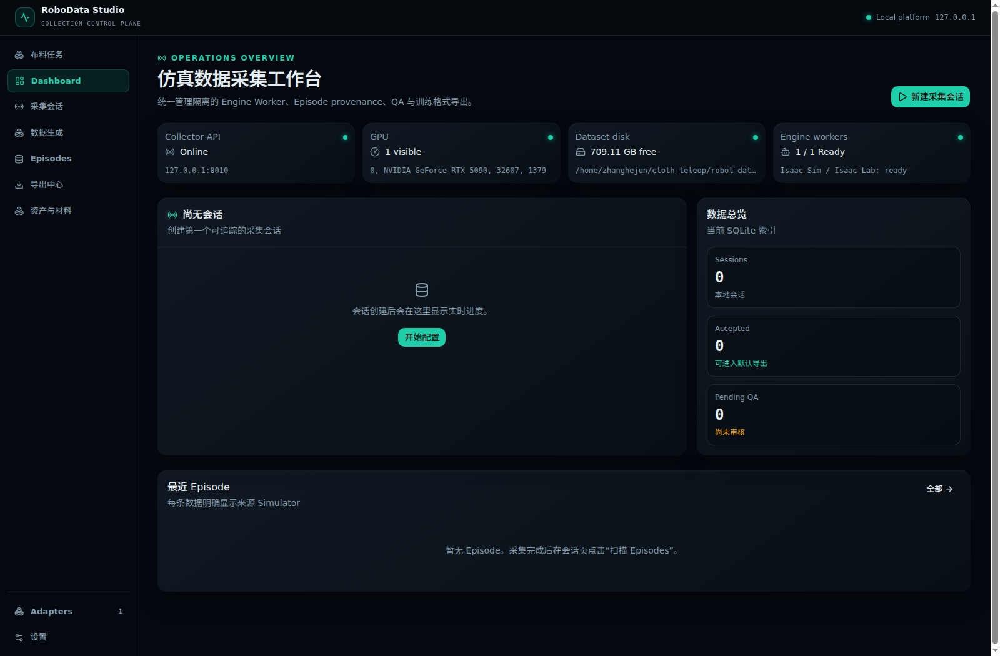
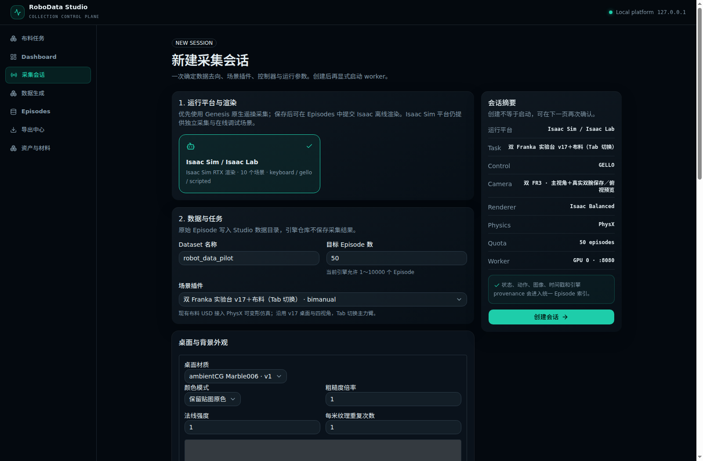
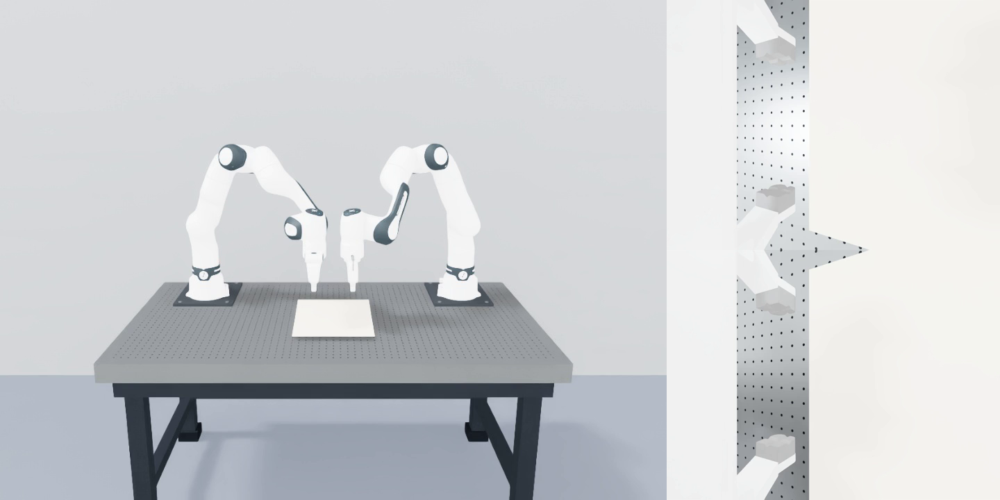

# 双 FR3／双 GELLO：5090 本机遥操手册

工作区为 `~/cloth-teleop`。代码来自 GitHub 固定版本，SDK 已单独迁移。
本轮 UI／仿真验证结果保存在 Studio 的 `data/deploy/franka5090/ui_smoke_001/`；
以其中实际报告和画面为准。双 USB 实物控制、现场延迟和夹布效果仍需上机确认。

2026-10-19：已在 5090 保存三路 960×720、10 秒静止录像，但布料日志仍报
`Deformable body view is not valid`。因此先进行空工位双 GELLO 校准；
布料可用于检查画面与录制，修复柔体物理之前不开始正式夹布示范采集。
远程 WebRTC 主画面本轮未通过，四路辅助预览可用；现场先看本机 Isaac 窗口。


## 明天先照这一页做：2026-10-20

**第一轮目标：两套 GELLO 分别控制仿真的左右 FR3，保存并回放一条 10–20 秒试操作。**
先用空工位。布料物理仍报错，明天可以看布料画面，但暂不把夹布录制当作有效示范。
以下使用电脑上的仿真；不启动实验室真实 FR3 的控制柜、Desk 或运动服务。

### A. 先认线：是不是直接插电脑 USB？

**电脑这一端，是把每套 GELLO 的 USB 转接器分别插到 5090 的 USB 口。**
不是把舵机的小接口直接塞进电脑，也不是插到真实 Franka 控制柜。
已有整套线束若已经装好，先保持原样；确认所属左右后再接电脑。

```text
连接关系示意（不是接口照片，也不代表电源接法）

左 GELLO ── 已配套的舵机总线／USB 转接器 ── USB 数据线 ── 5090 USB 口 A
右 GELLO ── 已配套的舵机总线／USB 转接器 ── USB 数据线 ── 5090 USB 口 B
                                                        │
                                                   本机浏览器
                                                        │
                                                仿真左／右 FR3
```

| 你看到的部件 | 明天怎么处理 |
| --- | --- |
| 能插电脑的 USB 插头 | 每套分别接到 5090 的 USB 数据口，给线贴左／右标签 |
| USB 转接小板或盒子 | 使用 GELLO 原来配套的设备；型号和板上接口仍待现场确认 |
| 舵机之间的小插头／多针排线 | 属于总线，不是电脑 USB；已经接好的保持原样 |
| 电源适配器／圆孔／电源端子 | 是否需要独立供电取决于实物；目前没有型号、额定电压和极性证据，不猜着插 |

**USB 插上能枚举，只证明电脑看见转接器，不代表全部舵机已供电或能读到。**
如果线束散开、没有配套电源，或不清楚哪个口接电：先拍两套 GELLO 全貌、转接板正反面、
电源铭牌和现有连线，交给实验室熟悉设备的人确认。不要试插不同电源或带电重接舵机线。

### B. 先插一套，确认左右，再插第二套

1. 登录 5090 上自己的桌面账号，打开终端。两套 GELLO 暂不连接网页控制。
2. 先查看当前设备，已有的其他串口不要拔：

```bash
ls -l /dev/serial/by-id
id -nG
```

3. 只插准备当作左主臂的 USB，再执行第一条命令，记下新增的完整 `usb-...` 名字。
4. 再插右侧 USB，记录第二个新增名字。如果没有新增设备，先查数据线／USB 口／设备连接。
5. `by-id` 目录不存在表示目前没有这个目录，不能单凭它认定驱动坏了。补查：

```bash
lsusb
ls -l /dev/ttyUSB* /dev/ttyACM*
```

星号没有匹配时会提示不存在。两套独立 USB 一般应能分别识别；若转接器序列号相同、
设备名有歧义，依靠一次只插一套辨认，不靠 `ttyUSB0/1` 的编号猜左右。

浏览器需要 Chrome／Edge 和串口权限。2026-10-19 检查时只发现 Firefox，当前账号也未加入
`dialout`；这两项尚未配置。可以先做下面的 UI／画面检查，再按第 1 节完成准备。

### C. 启动网页，再启动空工位

```bash
cd ~/cloth-teleop/robot-data-studio
bash scripts/start_franka5090.sh
```

保持终端开着。浏览器打开 [Studio 本机入口](http://127.0.0.1:3000)。
以下截图来自 2026-10-19 的实际远程部署验证，窗口布局可能随页面宽度变化。



新建会话，选择 Isaac Sim、空工位 `bimanual_tabletop_v17`、双 GELLO、PhysX、GPU 0、
相机 `isaac_fr3_dual_wrist_v1`、960×720、20 Hz。双 FR3 选项与本机部署保持一致。
如果网页没有这些选项，保留截图和终端错误，不改用其他机器人硬凑。



网页启动 worker 后，等待仿真就绪，再打开 Collector。首次着色器编译可能数分钟。
**本机优先看 Isaac 窗口**；远程 WebRTC 主画面本轮没有通过，黑屏不等于仿真一定没启动。

### D. 接通两侧后，先校准，再允许控制

1. 保持 **Enable control 关闭**。在 Collector 中分别连接左／右 GELLO，按刚才的 USB 标识选择。
   沿用 57600 baud，不修改板上波特率或舵机 ID。
2. 连接后先看每侧是否持续有新的关节读数。电脑识别 USB 但无读数时，检查配套供电、
   总线与页面错误；不要反复开关控制。
3. 两套主臂放到舒适起始姿态，分别采集 arm home，再采集每侧夹爪张开／闭合端点。
   这里的采集 home 是标定主臂与当前仿真姿态的对应；不运行真机 Move Home 命令。
4. 完成两侧标定后启用控制。先缓慢移动左边一个关节，确认仿真左臂跟随、右臂保持；
   再试右边和两侧夹爪。如果左右反了或方向反了，先关闭控制再修正配置。
5. 暂不追求快动作。浏览器控制标签保持前台；观察两臂是否连续跟随、有无跳变。

### E. 只录一条，再回放

第一条写清任务是“空工位双 GELLO 左右臂及夹爪试操作”，录 10–20 秒。
点击 Start Recording，分别做小动作，再停止并保存；标记结果时按实际任务判断。
这是接通检查，不能作为成功折衣示范。

保存三路：**主视角 main、左腕 left_wrist、右腕 right_wrist**，各 960×720，默认 10 Hz。
停止 worker 后在 Studio 扫描会话、打开 Episode，确认能回放三路及左右关节／夹爪序列。
数据在 `data/datasets/<dataset>/raw/<session>/episode_XXXXXX/`；以页面显示的实际目录为准。



这张图只证明显示和录制：布料仍报 `Deformable body view is not valid`，双腕也没有很好地
覆盖整件布料。待这些问题处理后，再开始正式夹布／折衣采集。

### F. 退出与遇到问题怎么办

关闭 Enable control → 停止并保存录制 → 在网页断开两套 GELLO → 停止本次 worker →
启动终端 Ctrl+C → 必要时再拔电脑端 USB。主臂供电按实验室现有流程关闭。

| 现象 | 下一步 |
| --- | --- |
| USB 插了但系统无新设备 | 检查是否数据线、是否插对电脑；记录 `lsusb` 和设备节点，先不重接内部线束 |
| Firefox 没有串口连接功能 | 换已安装的 Chrome／Edge；缺浏览器时先准备安装，不反复重启仿真 |
| Permission denied／端口不能打开 | 看串口节点权限、`id -nG`；按第 1 节处理后退出桌面重登 |
| 端口已被占用 | 先关其他读取同一 GELLO 的程序；不批量杀进程 |
| USB 可连接但没有关节数据 | 查页面错误及配套供电／总线；USB 枚举不代表舵机就绪 |
| 仿真窗口有画面，网页主画面黑 | 本轮 WebRTC 有已知问题；先看本机窗口与辅助预览，保留日志 |
| 只有一边动／两边都保持 | 关闭控制，核对两侧连接、新样本与标定；一侧过期会触发双臂保持 |
| 布料不动或穿透 | 已知柔体物理未通过，不据此判断遥操失败；先完成空工位检查 |

遇到问题保留：页面截图、启动终端最后几十行、USB 转接板／供电照片。
不要删除旧环境、改碰撞或用 `chmod 666` 排错。后面的章节保留完整技术说明。

---

## 1. 到实验室先准备这些

- 登录自己的 Linux 图形桌面账号，不在其他同学的桌面启动窗口。
- 准备两套 GELLO、两根独立 USB 线及对应转接器，给左右两套贴标签。
- 使用支持 Web Serial 的桌面 Chrome／Edge。当前检查只发现 Firefox；
  Firefox 不能完成这套 Web Serial 操作。浏览器安装和系统串口授权尚未执行。
- 这是仿真采集，不需要打开真实 FR3 控制服务或执行真实机械臂回零。
- GELLO 的电源／总线接口按实验室硬件说明确认；不确定时先拍实物确认，不猜接线。

先只插左侧 USB，在终端执行：

```bash
ls -l /dev/serial/by-id
id -nG
```

记下完整的 `usb-...` 标识；再插右侧 USB，重新执行第一条命令，记下新增设备。
`ttyUSB0/1` 编号可能改变，不能靠编号猜左右。检查两台设备对应的节点是否对当前
账号可读写，例如：

```bash
ls -l /dev/ttyUSB0 /dev/ttyUSB1
```

若网页看不到端口或报 Permission denied，先停在连接步骤并保留错误。
当前账号尚未加入 `dialout`，系统权限修改需要管理员单独处理。管理员批准后，
可以给当前操作账号加入串口组：

```bash
sudo usermod -aG dialout "$USER"
```

然后完整退出图形桌面并重新登录，重新执行 `id -nG` 确认有 `dialout`，再打开浏览器。
仅新开终端通常不会更新已运行浏览器的组权限。本轮未执行此系统修改。
不使用 `chmod 666`、全局 udev 改动或写入 GELLO EEPROM。
Chrome／Edge 也需要管理员预先安装；可以从其官方 Linux 下载入口选择 Ubuntu／Debian 包。
浏览器没有准备好时，先验证 UI 和仿真显示，暂不做串口连接。

## 2. 启动、校准与第一条录制

在自己的桌面终端执行：

```bash
cd ~/cloth-teleop/robot-data-studio
bash scripts/start_franka5090.sh
```

保持终端运行。用 Chrome／Edge 打开 `http://127.0.0.1:3000`。
若端口被占用，启动脚本会报错并保留已有服务；查看终端给出的日志目录。
远程验证使用 `--remote-preview`，现场本机使用默认的 `--local-display`。
FR3 启动脚本通过 `ROBOT_DATA_STUDIO_ENABLED_ENGINES=isaac_sim` 只启用本机已部署的引擎，
不会要求安装 ClothTwin／Genesis。平台不设置此变量时仍保留原来的三个引擎。
启动脚本只运行 UI/API；在网页会话中点击启动，才会创建仿真 worker。

1. 新建 Isaac Sim 会话，选择双臂 v17 场景、**双 GELLO**、**PhysX**、GPU **0**、
   `isaac_fr3_dual_wrist_v1`、**960×720**，控制频率沿用 **20 Hz**。
   先确认空工位显示正常，再选 `bimanual_tabletop_v17_cloth` 查看布料。
2. 启动 worker、打开 Collector。首次运行会编译 RTX 着色器，可能需要数分钟；
   日志中的 `Waiting for compilation of ray tracing shaders` 是编译进度，不要反复点击启动。
   看本机 Isaac 窗口，辅助预览有主视角、俯视和双腕。
   录制保存的是 **main / left_wrist / right_wrist** 三路，默认 **10 Hz**。
3. 保持 Enable control 关闭。分别点击左右 GELLO 的连接按钮，手动选已记录的 USB。
   串口沿用 **57600 baud**；不调整硬件参数。
4. 两套主臂放在舒适的起始姿态，分别采集左右 arm home，使其对应各自当前仿真姿态。
   再分别采集夹爪完全张开／闭合端点。每次重启仿真后重新核对，不盲用旧校准。
5. 启用控制后，先只小幅移动左侧一个关节，再试右侧；确认另一侧保持，随后试夹爪。
   方向相反时关闭控制，调整对应关节方向后再试。两侧都正确后才一起操作。
6. 第一条只录 **10–20 秒**：填写任务指令，Start Recording，做少量缓慢动作，
   然后 Stop／保存并按实际结果标记 Success 或 Failure。试操作不自动算成功示范。
7. 停止本次 worker，在 Studio 扫描该会话并打开 Episode 审核，确认三路图像、
   左右动作及时间序列都在。先回放第一条，再开始正式的 5–10 条种子采集。
8. 退出顺序：关闭 Enable control → 结束并保存录制 → 断开两侧 USB →
   在 Studio 停止本次 worker → 启动终端按 Ctrl+C 关闭 UI/API。

浏览器控制标签保持前台可见。任一侧样本过期时两臂会一起保持目标；若出现僵住，
先看左右连接与新样本状态，再看日志，不通过反复重发旧数据绕过看门狗。

## 3. 控制、数据与低延时

路径：两套USB → 本机浏览器各自的GelloSerialReader → localhost WebSocket → 两个关节目标控制器 → 同一个仿真步。Studio后端管理生命周期，不转发关节控制包。控制不绕经训练服务器；画面优先本机Isaac窗口，不等待WebRTC。

GelloCommandV1保持单臂七关节+二值夹爪，新增可选arm=left/right；双臂入口必须显式指定arm。浏览器使用同一个session和全局递增sequence，服务端只允许一个操作者控制两侧，再将命令路由到各自控制器。单臂消息不要求arm，单臂入口拒绝带arm的消息。新双臂客户端需要本轮服务端，不能连接旧版服务端。

限位、速度限制、序列检查与接收时钟看门狗继续生效；一侧过期时另一侧也保持，不用反复发送缓存读数伪装新输入。浏览器发送缓冲积压时关闭控制，避免排队重放旧动作。默认看门狗窗口沿用0.3s，不等于立即急停或真实机器人安全保证。

FR3选项显式使用fr3_joint1..7、fr3_finger_joint1/2、fr3_hand及指定FR3 USD；Panda仍走原路径，不按文件名猜模型。FR3首轮仅开放PhysX双臂v17；没有修改USD碰撞或材料。仿真驱动沿用原High-PD配置，执行器关节表达式映射至FR3，尚未证明与真机动力学一致。

录制沿用Canonical Episode：原生18维双臂关节/双指目标，写入器转换为既有16维训练动作；原生36维实测关节位置/速度由既有适配器转换为32维policy_state。FR3记录显式使用robot_id=franka_fr3_dual和dual_fr3_joint16_physical动作配置，字段名保留fr3，不冒充Panda。operator_action为左右各7关节+1二值夹爪，共16维。不要把夹爪命令0/1与实测米制总宽度相减或互换。保留requested/safe/applied动作区别。

双GELLO附加数组：dual_control_sequence、dual_control_source_timestamp_ns、dual_control_receive_timestamp_ns（均按left/right顺序），dual_coupled_hold、两侧末端姿态；PhysX布料帧附带cloth_particles与cloth_particle_velocities。节点状态不是完整可恢复的求解器检查点；尚未实现SoftMimicGen种子导入。dual_active_arm=-1表示两臂同时操作，不表示切换键盘主力臂。

FR3部署新增独立相机配置 `isaac_fr3_dual_wrist_v1`，960×720，录制频率沿用10Hz。预览四路：主视角、俯视、真实左腕、真实右腕；保存仅三路 `main / left_wrist / right_wrist`。预览线协议继续使用base/top/side/wrist四个ID，映射关系保存在recording_camera_map，side/wrist在本配置中分别是真实左右腕，不再是外部斜视图；旧v4/v5行为保持。原生Isaac窗口仍可自由观察。

Top辅助预览采用接近之前LeHome／FR3的高位斜俯视：eye_world_m=(.55,.37,2.02)，target_world_m=(.55,-.06,.78)，垂直FOV45°；替换原约3m高、FOV52°的近垂直全桌视角，目的是让衣物操作区占更多画面。只调整Top，主视角与双腕以及三路保存映射不变。实际截图需由操作者确认。

新配置把相机挂在实际左右机器人prim的fr3_hand下，ROS相机约定，位置(.08,0,.02)m，局部旋转xyzw=(0,-.229753,0,.973249)。该挂载来自已有LeHome FR3参数并显式从wxyz转换；当前IsaacLab OffsetCfg使用xyzw。标定元数据记录保存流名称、K、prim路径和动态父坐标局部位姿，不能把腕相机局部外参解释为固定世界外参。该配置仍是nominal_pending_intrinsics；2026-10-19已在GPU生成静止腕部图像，但取景偏离操作中心，尚未验证手部运动跟随和有效衣物覆盖。

Studio在FR3部署的双臂v17页面默认选择新相机配置，并选用已存在的MAT-ambientcg-marble006 v1三贴图大理石台面外观；保持v17工作台几何、碰撞和双臂布局。此处是现有工作台的大理石外观，不代表已核实与实验室某张石台尺寸一致。启动配置显式携带材质ID/版本，资产闭包需包含该材质三张贴图，不能只复制材料目录。旧场景和已有会话不自动改写。

Canonical Episode仍为原始数据；未来LeRobot导出可对应observation.images.main/left_wrist/right_wrist。此次未导出LeRobot，也未训练。

先测量再调参：

- 真实新USB样本频率、每侧source/receive时间和控制tick时间分别记录；不把重复目标计为新USB采样。
- 网页显示每侧接收到控制tick的p50/p95，使用服务端单调时钟。它不包含USB读取前延迟、图像渲染或显示器延迟，不能称为端到端延迟。
- 端到端输入到画面需现场测量；不同进程/浏览器的时钟未校准前不直接相减。来源时间与接收时间分开保存。
- 当前57600 baud、20Hz轮询和16ms FTDI配置先保持不动。更高波特率、latency_timer和滤波调整须有独立明确范围；不能只提高发送频率后宣称延迟下降。
- 录制和辅助预览分开限速；原生窗口改善视觉路径。不能为了流畅悄悄降低物理精度或丢掉录制帧。

## 4. 实验室教程核对

来源：[Franka真机教程.html](https://ipplab-org.feishu.cn/wiki/Fxrjw3RD1iPtUhkpAX1cGxsRnZd)。已读取用户上传的同名HTML附件；未执行其中任何命令，也未把其中的启动命令当作本次授权。

教程说明：按buffer实际到达时间取样，分别保留generated_stamp和buffered_stamp；采集、推理、重播使用相同取样规则。真机工程以60Hz动作grid运行，但GELLO新读数实测约31Hz，相机约30Hz，grid允许重复沿用已收到的有效输入。这些是教程里的真机测量，不是当前Studio20Hz Web Serial的测量。

教程中的state第8维为实测夹爪总宽度m，action第8维为0=open/1=grasp。教程中的teleop_smoothing_sec默认0.2s，属于输入滤波，不是网络延迟。当前Studio直控没有复用该真机节点的0.2s滤波。

教程也注明有些dry_run模式仍会执行Home。所以仿真手册不复制真实FR3 launch/home命令，不把dry_run一词当作“不运动”的保证。以后要操作真机时单独核对该教程与当前真机工程版本。

## 5. 已部署目录与排查入口

| 路径（相对 `~/cloth-teleop`） | 内容 |
| --- | --- |
| `robot-data-studio` | Studio UI/API、配置和采集数据 |
| `gello-remote` | 固定版本 worker 和匹配的双 GELLO Collector |
| `IsaacLab` | 固定官方版本及两个启动补丁 |
| `isaacsim_6.0.1` | 独立 SDK；`IsaacLab/_isaac_sim` 指向此处 |
| `.venvs/isaaclab` | 独立仿真 Python 环境 |

- 启动脚本输出 `data/deploy/franka5090/launch_*/`，其中有 `api.log`、`ui.log`。
- worker 日志与输出目录在 Studio 会话中查看。
- 本轮启动记录、截图和短视频位于 `data/deploy/franka5090/ui_smoke_001/`。
- 布料 PhysX 初始化曾有警告；画面显示正常不代表已经验证抓布或折衣成功。
- 既有旧目录保留；不要为排错删除其他人的环境、进程或数据。

## 6. 少量示范后如何扩增

- [DexMimicGen](https://arxiv.org/html/2410.24185v2)：每臂子任务分段、协调阶段同步和先后约束。借鉴双手协作时序；主要公开任务不是衣物。
- [SoftMimicGen](https://arxiv.org/html/2603.25725v1)：用柔体节点状态做非刚性配准并变换末端轨迹，在仿真中重新执行。当前项目只验证了原生Panda毛巾生成，不代表已接通本项目FR3扩增。
- [DexGarmentLab](https://arxiv.org/html/2505.11032v1)：人工任务顺序与抓点，借助衣物结构对应迁移抓点并按衣物大小调整轨迹；灵巧手控制不能直接替换为原装夹爪。

建议一条完整短裤对折视频 → 5–10条人工认可种子 →20条自动生成候选并看视频 →确认物理抓取和折后形状后再扩量训练。这里是后续路线，不是本轮已经实现的功能。
